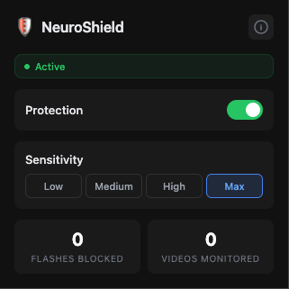
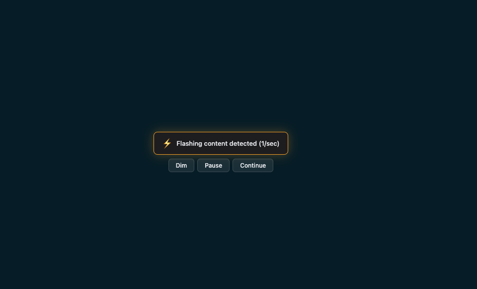
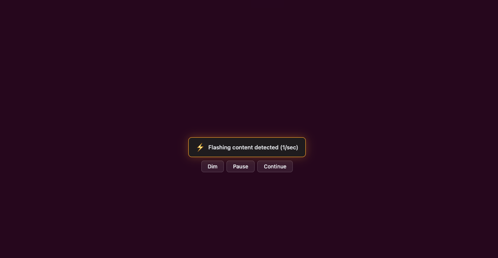
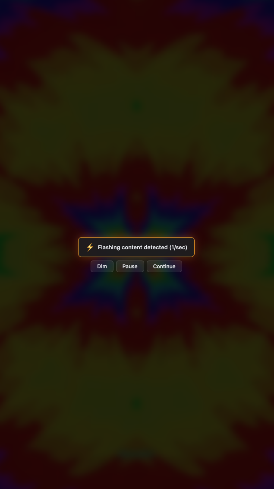

# NeuroShield

**Real-time photosensitivity protection for the web.**

[](https://chromewebstore.google.com/detail/neuroshield/dbmdhjhmfmdnohcphcmdlfaiipdoldfk) [](https://chromewebstore.google.com/detail/neuroshield/dbmdhjhmfmdnohcphcmdlfaiipdoldfk) [](LICENSE) [](#testing)

A Chrome extension that detects and blocks flashing, strobing, and dangerous visual patterns across **all** websites — protecting people with epilepsy, migraines, and visual snow syndrome.

```
Video starts playing → NeuroShield samples frames at 15 fps
  → WCAG 2.3.1 luminance analysis detects 4 flashes/sec
  → Dark overlay blocks the content instantly
  → User chooses: [Dim] [Pause] [Continue]
```

<p align="center">
  
  &nbsp;&nbsp;
  
</p>
<p align="center">
  
  &nbsp;&nbsp;
  
</p>

---

## Why This Exists

3% of people with epilepsy have photosensitive seizures triggered by visual stimuli. Over 1 billion people live with migraines. Visual Snow Syndrome affects 2-3% of the population. Every existing flash detection tool only works on YouTube. The rest of the web — social feeds, news sites, ads, games — is unguarded.

NeuroShield works everywhere.

---

## Features

- Real-time flash detection using WCAG 2.3.1 luminance thresholds with sRGB linearization
- Works on every website — not just YouTube
- Warning overlay with dim, pause, and continue controls
- Protective CSS filter fallback for cross-origin videos
- Sensitivity from WCAG standard (3 Hz) down to maximum protection (1 Hz)
- Accessible overlay: ARIA roles, keyboard navigation (Escape to dismiss), screen reader support
- Starts at `document_start` — protects before any content renders
- Resilient: survives extension updates and service worker restarts

## Sensitivity Levels

| Level | Threshold | Best For |
|---|---|---|
| Low | 5+ flashes/sec | Minimal intervention — only extreme strobing |
| **Medium** | **3+ flashes/sec** | **Default. WCAG 2.3.1 standard** |
| High | 2+ flashes/sec | Migraine and VSS sufferers |
| Maximum | 1+ flash/sec | Full protection |

---

## Install

### Chrome Web Store (recommended)

**[Install NeuroShield](https://chromewebstore.google.com/detail/neuroshield/dbmdhjhmfmdnohcphcmdlfaiipdoldfk)** — one click, auto-updates.

### Manual install (development)

```bash
git clone https://github.com/OMARVII/Neuroshield.git
```

1. Open `chrome://extensions`
2. Enable **Developer mode** (top right)
3. Click **Load unpacked** → select the cloned folder
4. Done. NeuroShield is active on all tabs.

No build step. No dependencies. No accounts.

---

## How It Works

**TL;DR:** Sample video frames → compute WCAG luminance → count flash transitions → block if dangerous.

The detection engine (`src/detector.js`) samples media elements at 15 fps via `requestAnimationFrame`, downscaled to 32x32 pixels for performance. Each frame is analyzed using sRGB linearization (IEC 61966-2-1) and ITU-R BT.709 relative luminance — the same math the WCAG spec mandates.

A sliding 1-second window counts opposing luminance transitions. If the delta exceeds 0.1 and the darker state is below 0.80 relative luminance, it counts as a flash. Three or more flashes per second triggers the overlay. Red flash detection uses the R/(R+G+B) saturation ratio per WCAG 2.3.2.

Cross-origin videos where pixel analysis is blocked by browser security get an opt-in protective CSS filter instead.

---

## Architecture

```
neuroshield/
├── src/
│   ├── detector.js      ← WCAG 2.3.1 flash detection engine (core algorithm)
│   ├── content.js       ← Content script: finds media, attaches detectors
│   ├── overlay.js       ← Warning overlay UI with dim/pause/continue
│   ├── background.js    ← Service worker: state, badges, cross-tab messaging
│   ├── neuroshield.css  ← Overlay styles
│   └── popup/           ← Extension popup (settings UI)
├── test/
│   └── detector.test.js ← 84 unit tests for the detection algorithm
├── manifest.json        ← Chrome MV3 manifest
├── eslint.config.js     ← Linting rules
└── PRIVACY.md           ← Privacy policy (no data collection)
```

---

## Development

```bash
npm install          # Install dev dependencies (ESLint only)
npm test             # Run 84 unit tests (Node.js built-in test runner)
npm run lint         # Run ESLint
npm run validate     # Run both lint + tests
```

Tests cover sRGB linearization, BT.709 luminance, frame analysis, flash counting thresholds, sensitivity boundaries, red flash detection, severity classification, spatial region analysis, canvas context loss, and end-to-end pixel pipeline. Zero external test dependencies.

## Testing

84 tests across 13 suites:

| Suite | Tests | Covers |
|---|---|---|
| sRGB linearization | 8 | Piecewise formula, boundary, monotonicity, full range |
| Relative luminance | 8 | BT.709 coefficients, linearity, channel isolation |
| Frame analysis | 11 | RGB pixels, mixed frames, alpha independence, FP32 consistency |
| Sensitivity presets | 6 | All levels, ordering, WCAG medium=3 |
| Flash detection | 14 | Opposing transitions, thresholds, red flash, severity |
| Realistic 15fps simulation | 2 | Real-time frame rate flash detection |
| FlashDetector class | 6 | Lifecycle, sensitivity updates, destroy |
| CSSFlashDetector | 9 | Lifecycle, `_parseColor` edge cases |
| End-to-end pipeline | 3 | Real pixel data through full analysis chain |
| analyzeFlashWindow | 4 | Shared helper, no-flash baseline, red flash, severity |
| CSSFlashDetector unified | 2 | Red flash via CSS colors, severity classification |
| Spatial analysis | 5 | Region-based detection, localized flash, whole-frame fast path |
| Canvas context loss | 3 | Context lost/restored events, destroy cleanup |

---

## Privacy

NeuroShield runs entirely locally. No data leaves your browser. No analytics. No tracking. Period.

See [PRIVACY.md](PRIVACY.md) for the full policy.

---

## Contributing

See [CONTRIBUTING.md](CONTRIBUTING.md) for development setup, code style, and PR process.

This is a medical safety tool. Algorithm changes require test evidence.

---

## License

[MIT](LICENSE)
