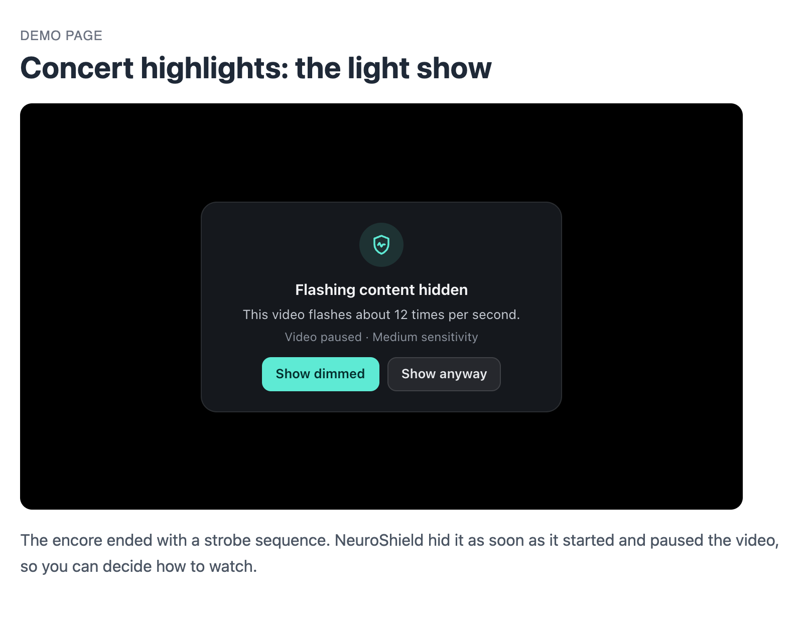
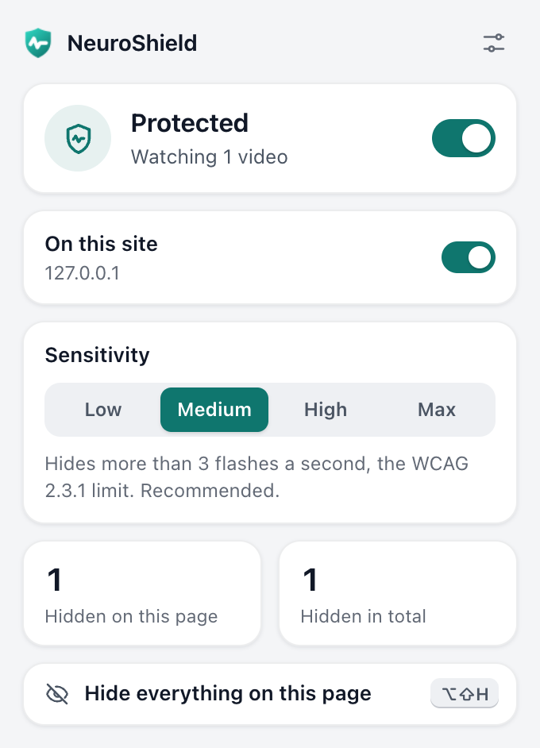

<p align="center">
  
</p>

<h1 align="center">NeuroShield</h1>

<p align="center"><strong>Real-time photosensitivity protection for the whole web.</strong></p>

<p align="center">
  <a href="https://chromewebstore.google.com/detail/neuroshield/dbmdhjhmfmdnohcphcmdlfaiipdoldfk"></a>
  <a href="https://github.com/OMARVII/Neuroshield/actions/workflows/ci.yml"></a>
  <a href="LICENSE"></a>
</p>

NeuroShield is a Chrome extension that watches videos, canvases and animations on every website and hides content that flashes faster than WCAG 2.3.1 allows, usually within a fraction of a second. It's built for people with photosensitive epilepsy, migraine and visual snow.

<p align="center">
  
  &nbsp;
  
</p>

## Why

Around 3% of people with epilepsy have seizures triggered by flashing light, more than a billion people live with migraine, and visual snow affects 2–3% of the population. Most flash-protection tools only cover a single site. Flashing content shows up everywhere: in social feeds, news, ads and games.

## What it does

- **Hides flashing as it happens.** Every frame a video shows is measured against the WCAG 2.3.1 general and red flash thresholds. When the limit is crossed, the video is blacked out and paused.
- **Lets you decide what happens next.** *Show dimmed* lowers contrast so that even black-to-white flashing stays below the WCAG threshold. *Show anyway* reveals it, and NeuroShield starts watching again 10 seconds later.
- **Covers more than videos.** It checks canvases (games, HTML5 ads, WebGL) and short, repeating CSS animations, and it finds players inside shadow DOM and cross-origin frames.
- **Gives you a panic button.** <kbd>Alt</kbd>+<kbd>Shift</kbd>+<kbd>H</kbd> (or the popup) pauses every video and animation and covers the page instantly.
- **Respects your choices.** Settings apply to open tabs immediately, you can pause it per site, and it tells you when a video can't be scanned (cross-origin or DRM-protected) instead of guessing.
- **Shows you it works.** NeuroShield stays silent until something flashes. To check it, open its settings and press *Run test*: a strobe plays off screen, so nothing flashes on yours, and you see how fast it was caught and the card you'd see.
- **Stays out of the way.** All analysis runs on your device. It does next to nothing while nothing is playing, and its UI is isolated from page styles and works over fullscreen video.

### Sensitivity

| Level | Hides | Good for |
|---|---|---|
| Low | More than 5 flashes per second | Only intense strobing |
| **Medium** (default) | **More than 3 flashes per second** | **The WCAG 2.3.1 limit** |
| High | More than 2 flashes per second | Migraine, visual snow |
| Maximum | Any flash | Maximum caution |

Red flashes (changes to and from saturated red, the pattern behind the 1997 Pokémon incident) are counted too, even when brightness barely changes, and are treated as high risk.

## Install

**[Get NeuroShield from the Chrome Web Store](https://chromewebstore.google.com/detail/neuroshield/dbmdhjhmfmdnohcphcmdlfaiipdoldfk).** It updates automatically.

To run it from source:

```bash
git clone https://github.com/OMARVII/Neuroshield.git
```

Open `chrome://extensions`, turn on **Developer mode**, choose **Load unpacked** and select the cloned folder. There's no build step.

## How it works

1. **Find what can flash.** The content script runs in every frame. It finds `<video>` elements, large canvases and short repeating animations, including inside open and closed shadow roots and in custom elements that upgrade later.
2. **Read every frame cheaply.** Each presented video frame is uploaded into an sRGB texture. The GPU averages it down to 32×32 in linear light, and the result comes back through an asynchronous readback, so the page never waits (about 0.2 ms per 1080p frame). Canvases are read through `captureStream()`. Machines without GPU acceleration use a 2D-canvas fallback.
3. **Count flashes like WCAG does.** Relative luminance (sRGB linearization, BT.709) is tracked for the whole frame and for 16 regions, so a flash in one corner isn't averaged away. Transitions are measured peak to peak, so smooth or ramped flashes count as fully as hard cuts. Red flashes use the WCAG saturated-red definition.
4. **Protect, then ask.** The element is hidden with an inline filter that stays aligned while you scroll, and a card explains what happened.

On a 1080p60 video, NeuroShield 1.1 uses about **40% less main-thread time than 1.0 while analysing five times as many frames** (every frame instead of ~12 per second). See [docs/how-it-works.md](docs/how-it-works.md) for the details, measurements and known limits.

## Privacy

NeuroShield collects nothing, sends nothing and makes no network requests. Frames are reduced to 32×32 samples in memory and discarded. Settings, paused sites and a local count of hidden flashes stay in Chrome's local storage on your device. See [PRIVACY.md](PRIVACY.md).

| Permission | Why |
|---|---|
| Read and change data on all websites | Run the flash detector on every page, including tabs that were already open when NeuroShield was installed or updated. |
| `storage` | Remember your settings. |
| `scripting` | Start protection in tabs that were open before installation, without a reload. |

## Limitations

NeuroShield lowers exposure. It can't promise to catch everything, and it is not a medical device.

- Detection needs to see a few flashes first: about 0.3 seconds for fast strobing and up to a second near the threshold.
- Cross-origin videos without CORS, and DRM-protected streams (Netflix and similar), can't be read by any extension. NeuroShield shows a small notice and can dim them automatically.
- Reversing patterns (a checkerboard or stripes swapping black and white) aren't detected, because their average brightness doesn't change. At High and Maximum, fast motion can occasionally be taken for flashing.
- Animated GIF/WebP images and flashing done by scripts changing page colors aren't analyzed yet. Use <kbd>Alt</kbd>+<kbd>Shift</kbd>+<kbd>H</kbd> if something gets through, and please [report it](https://github.com/OMARVII/Neuroshield/issues/new?template=missed-flash.yml).

## Development

Requires Node 22+.

```bash
npm install
npx playwright install chromium   # once, for the end-to-end tests

npm run lint          # ESLint
npm run test:unit     # detector, settings and tab-state unit tests (Node test runner)
npm run test:e2e      # loads the extension into Chromium and plays real flashing videos
npm run build         # dist/neuroshield-<version>.zip for the Chrome Web Store
npm run bench         # main-thread cost on a 1080p60 video (needs ffmpeg)
```

The end-to-end suite covers detection of every fixture (including 12 Hz, red/blue and smooth flashes), shadow DOM, iframes, fullscreen, strict CSP pages, live settings changes, the popup and the background worker. The detection tests run twice: once with WebGL and once with the 2D fallback.

```
src/
├── shared/settings.js        settings shared by every context
├── content/                  runs in every frame
│   ├── detector.js           WCAG flash analysis (pure, unit-tested)
│   ├── sampler.js            WebGL / 2D frame readback
│   ├── guards.js             per-element protection (video, canvas, animation)
│   ├── overlay.js            on-page UI (top layer + closed shadow root)
│   └── content.js            discovery, settings, reporting
├── background/               service worker: toolbar, per-tab state, install
├── popup/                    toolbar popup
├── options/                  settings and welcome page
└── ui/tokens.css             shared design tokens (light and dark)
test/unit/                    Node unit tests
test/e2e/                     Playwright tests, test pages and video fixtures
scripts/                      build, icons, screenshots, fixtures, benchmark
```

## Contributing

Contributions are welcome. NeuroShield makes safety decisions, so detection changes need tests that show the before and after. See [CONTRIBUTING.md](CONTRIBUTING.md).

## License

[MIT](LICENSE) © Omar Khaled
